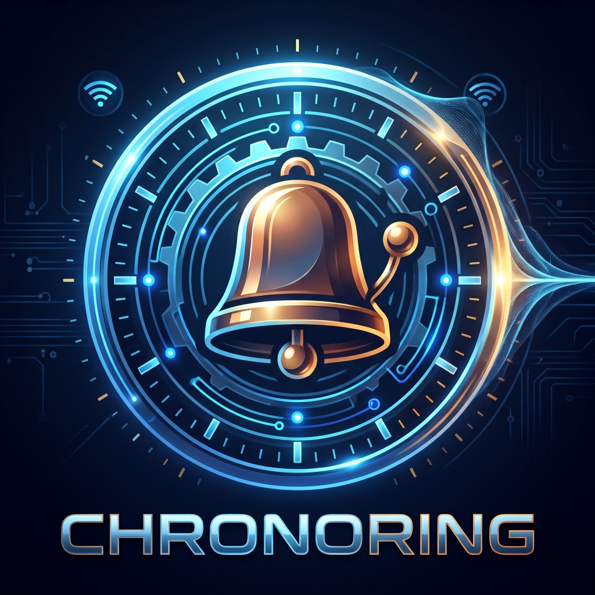

<div align="center">
  
  <h1>🔔 ChronoRing</h1>
  <p><strong>Sistema Intelligente di Automazione per Campanella Scolastica su architettura ESP32</strong></p>

  <p>
    
    
    
    
  </p>
</div>

---

## 📖 Descrizione del Progetto

**ChronoRing** è un sistema completo, affidabile e autonomo per la gestione automatizzata della campanella scolastica, progettato originariamente per la scheda **Freenove ESP32-S3 Display 2.8" (FNK0104B - N16R8)** ma dotato di **architettura universale Multi-Board & Headless**.

All'avvio, il firmware esegue una scansione hardware automatica sul bus I2C (`0x38`):
- **🖥️ Modalità Display Touch**: se rileva lo schermo con controller touch capacitivo `FT6336G`, avvia l'interfaccia grafica interattiva **LVGL v8** a 60 FPS, il client meteo **Open-Meteo** e la schermata di **Standby (Screensaver)** personalizzabile con Logo e Nome dell'Istituto.
- **⚡ Modalità Headless**: se nessun display è collegato (o se compilato su schede classiche `ESP32` / `ESP32-C3` / `ESP32-C6`), disattiva automaticamente i buffer grafici e opera come centralina pura tramite **Dashboard Web**, **Scheduler NTP** e **Relè**.

---

## ✨ Caratteristiche Principali

- **🕒 Sincronizzazione Oraria NTP & Fuso Orario Italiano Automatico**
  - Sincronizzazione con `pool.ntp.org` e `time.nist.gov`.
  - Gestione nativa del passaggio automatico tra **Ora Solare (CET)** e **Ora Legale (CEST)** tramite regola POSIX `CET-1CEST,M3.5.0,M10.5.0/3`.
- **📅 Scheduler Settimanale (Lunedì – Sabato)**
  - Programmazione oraria salvata in modo persistente su filesystem **LittleFS** (`/config.json`).
  - Calcolo in tempo reale del prossimo suono con conto alla rovescia.
  - Interruttore di **Sospensione Globale** (per vacanze, festività o sospensione attività didattiche) sincronizzato istantaneamente tra Display Touch e Dashboard Web.
- **🛡️ Sicurezza Hardware del Relè (Anti-Blocco)**
  - Spegnimento automatico gestito tramite timer hardware ad alta precisione (`esp_timer` one-shot).
  - **Hard Cap di sicurezza a 10 secondi (`10000 ms`)**: impedisce che la campanella resti incastrata o attiva oltre il limite massimo anche in caso di configurazione errata.
- **🌐 Web Dashboard & Aggiornamento Firmware OTA**
  - Pannello di controllo responsivo protetto da password amministratore, accessibile tramite indirizzo locale **`http://chronoring.local`** (mDNS) o IP.
  - Gestione in tempo reale di: *Suona Ora (Test Manuale)*, *Sospensione*, *Tabella Orari*, *Durata Impulso Relè*, *Credenziali Wi-Fi*, *Logo e Nome della Scuola*.
  - **Fallback Access Point automatico**: se la rete Wi-Fi non è configurata o non è raggiungibile entro 20 secondi, ChronoRing genera la rete Wi-Fi di emergenza **`ChronoRing-Setup`** (password: `admin123`) su `http://192.168.4.1`.
  - Pagina dedicata **`/update`** per l'aggiornamento del firmware **Over-The-Air (OTA)** direttamente dal browser caricando il file `.bin`.
- **🎨 Interfaccia Touch LVGL v8 & Standby Personalizzabile**
  - Layout scuro ad alto contrasto (`320x240` Landscape) con orologio digitale grande, countdown prossima campanella, widget meteo **Open-Meteo** con icone vettoriali moderne e configurazione Wi-Fi da schermo.
  - **Screensaver Standby automatico dopo 60 secondi**: riduce la luminosità della retroilluminazione (PWM a `15%`) per preservare il pannello IPS e mostra un orologio a tutto schermo accompagnato dal **Logo** e dal **Nome dell'Istituto Scolastico** caricati dalla Dashboard Web.

---

## 🔌 Schema di Collegamento Hardware (Freenove FNK0104B ESP32-S3)

| Periferica | Funzione | Pin ESP32-S3 | Note |
| :--- | :--- | :---: | :--- |
| **Modulo Relè** | Comando Campanella | **GPIO 44 (`RXD`)** | Pin `RX` del connettore UART a 4 pin della scheda |
| **Display ILI9341V** | SPI MOSI / MISO / SCLK | GPIO 11 / 13 / 12 | Bus SPI2 (`HSPI`) @ 40 MHz |
| **Display ILI9341V** | CS / DC / Backlight | GPIO 10 / 46 / 45 | Backlight PWM (Canale LEDC 7) |
| **Touch FT6336G** | I2C SDA / SCL | GPIO 16 / 15 | Indirizzo I2C `0x38` @ 400 kHz |
| **Touch FT6336G** | RST / INT | GPIO 18 / 17 | Usato per l'autorilevamento all'avvio |
| **LED RGB On-Board** | Stato Operativo | GPIO 42 | Verde fisso = Attivo, Rosso fisso = Sospeso |

### Ambienti Multi-Board Supportati in `platformio.ini`

| Ambiente PlatformIO | Scheda / Architettura | Pin Relè Default (`RELAY_PIN`) |
| :--- | :--- | :---: |
| `freenove_esp32_s3_n16r8` *(default)* | Freenove ESP32-S3 (16MB Flash + 8MB PSRAM OPI) | `GPIO 44` (`RX`) |
| `esp32_classic` | ESP32 WROOM / DevKit V1 (Dual-Core Xtensa) | `GPIO 4` |
| `esp32_c3` | ESP32-C3 SuperMini / DevKitM-1 (Single-Core RISC-V) | `GPIO 2` |

---

## ⚠️ Nota Importante sul Relè all'Avvio (Connettore UART a 4 Pin)

Sulla scheda **Freenove ESP32-S3**, il connettore UART a 4 pin espone `5V`, `GND`, `TX (GPIO 43)` e `RX (GPIO 44)`:
- **`GPIO 43` (`U0TXD`)** è cablato nel silicio dell'ESP32-S3 come uscita seriale del **ROM Bootloader**. Nei primissimi millisecondi di accensione (prima ancora che il firmware venga caricato), il chip porta `GPIO 43` a **3,3V** per trasmettere il log di avvio della ROM.
- Se utilizzi un modulo relè **Active HIGH** (che scatta quando riceve `3,3V`), quel breve segnale del bootloader può far eccitare il relè per una frazione di secondo durante il riavvio.
- Per eliminare completamente qualsiasi scatto al riavvio hai due soluzioni immediate:
  1. **Spostare il filo del segnale sul pin accanto (`RX` / `GPIO 44`)** dello stesso connettore a 4 pin e impostare `#define RELAY_PIN 44` in `src/hardware_pins.h` (poiché `RX` è un ingresso durante il boot e non trasmette dati).
  2. **Oppure usare la logica `Active LOW`**: se il modulo relè dispone del ponticello `H/L` (High/Low Trigger), impostalo su **`L` (Low Trigger)** e imposta `RELAY_ACTIVE_LOW = true` in `src/hardware_pins.h`. In questo modo i `3,3V` presenti su `GPIO 43` durante il boot corrisponderanno esattamente allo stato **Relè Spento**.

---

## 🚀 Compilazione e Installazione

### Prerequisiti
- [Visual Studio Code](https://code.visualstudio.com/) con estensione [PlatformIO IDE](https://platformio.org/).

### Comandi Rapidi CLI
```bash
# Compilazione per la scheda principale Freenove ESP32-S3 N16R8
pio run -e freenove_esp32_s3_n16r8

# Caricamento firmware via USB
pio run -e freenove_esp32_s3_n16r8 -t upload

# Apertura Monitor Seriale (115200 baud)
pio device monitor
```

### Comandi Diagnostici da Monitor Seriale (`115200 baud`)
- `t` : Attiva manualmente la campanella per la durata configurata (`Suona Ora`).
- `s` : Arresta immediatamente il relè (`Force Off`).
- `w` : Forza un aggiornamento immediato dei dati meteo da Open-Meteo.
- `p` : Stampa il report diagnostico completo (Orario, Rete, Prossimo Suono, Meteo, LittleFS).

---

## 📂 Struttura del Progetto

```text
Esp32-Campanella/
├── docs/
│   └── chronoring_logo.jpg          # Logo ufficiale ChronoRing
├── include/
│   └── lv_conf.h                    # Configurazione LVGL v8.3 (PSRAM / SRAM dinamica)
├── src/
│   ├── gui/
│   │   ├── display_touch_driver.h   # Probe I2C 0x38, driver LovyanGFX ILI9341V + FT6336G
│   │   ├── display_touch_driver.cpp
│   │   ├── gui_manager.h            # Interfaccia LVGL, icone meteo vettoriali e Standby
│   │   └── gui_manager.cpp
│   ├── network/
│   │   ├── network_manager.h        # Gestione Wi-Fi STA, Fallback AP, mDNS e NTP POSIX
│   │   ├── network_manager.cpp
│   │   ├── weather_service.h        # Client HTTPS asincrono Open-Meteo
│   │   ├── weather_service.cpp
│   │   ├── web_server_handler.h     # Dashboard Web, API REST JSON, Upload Logo e OTA
│   │   └── web_server_handler.cpp
│   ├── scheduler/
│   │   ├── scheduler.h              # Motore orario settimanale a 1 Hz (Lun-Sab)
│   │   └── scheduler.cpp
│   ├── config_manager.h             # Persistenza /config.json e /school_logo.bin su LittleFS
│   ├── config_manager.cpp
│   ├── hardware_pins.h              # Mappatura pin condizionale Multi-Board
│   ├── relay_controller.h           # Driver Relè fail-safe con esp_timer e Hard Cap 10s
│   ├── relay_controller.cpp
│   └── main.cpp                     # Entry point del sistema
├── partitions_16MB.csv              # Tabella partizioni custom 16MB (Dual OTA + 7.8MB LittleFS)
└── platformio.ini                   # Configurazione ambienti Multi-Board PlatformIO
```

---

## 🔐 Credenziali Predefinite

- **Access Point di Emergenza Wi-Fi**:
  - **SSID**: `ChronoRing-Setup`
  - **Password**: `admin123`
  - **URL**: `http://192.168.4.1`
- **Dashboard Web (`http://chronoring.local`)**:
  - **Password Amministratore di default**: `admin` *(modificabile dalla Dashboard)*
